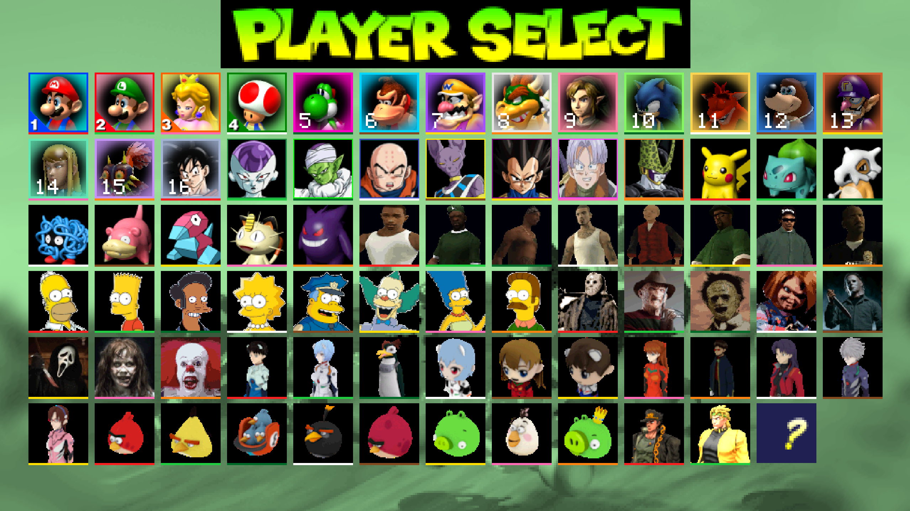
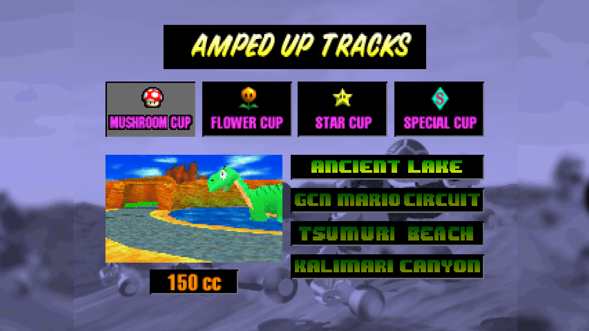
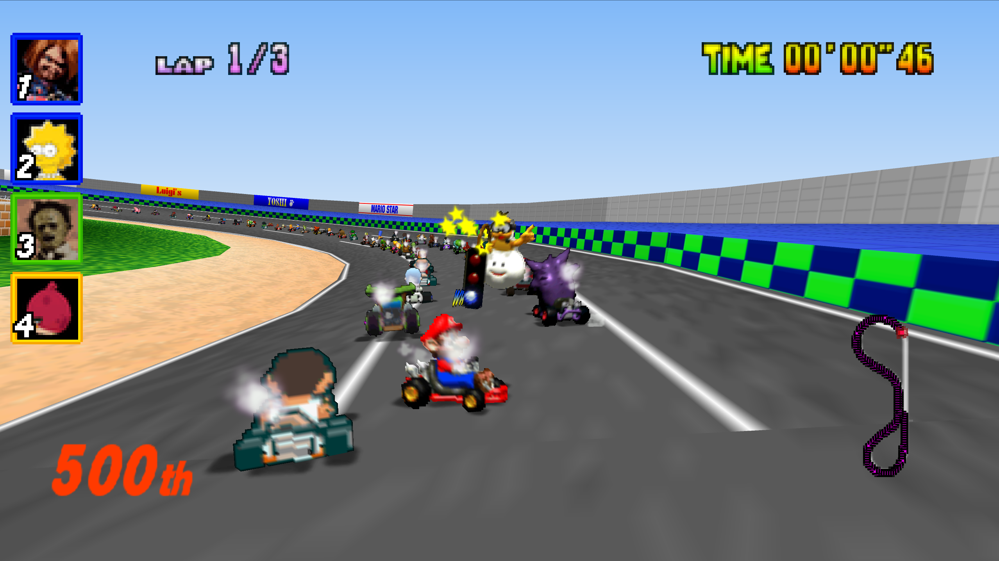

# Mario Kart 64 PC Ultimate — Ricky Gameplays

Unofficial fork of [HarbourMasters/SpaghettiKart](https://github.com/HarbourMasters/SpaghettiKart). Original PC port and engine by HarbourMasters and the SpaghettiKart contributors; customization by Ricky Gameplays.

Follow [Ricky Gameplays on YouTube](https://www.youtube.com/@Ricky_Gameplays-Caballo).

## Screenshots

**Online multiplayer is in beta.** Expect bugs and use matching game versions when playing online.

## Added features

- **Up to 16 local players** in Grand Prix, VS and Battle, with optional bots filling race grids.
- **Change racer class:** press L or R on the character select screen to cycle through classes, changing the selected character’s weight and handling.
- **AFK takeover:** inactive players become bots after a configurable timeout; controller input immediately restores human control. Bots can use items, with separate race and Battle behavior.
- **1, 2 or 3 monitors**, improved split-screen layouts, duplicate character selection and saved controller-device assignments.
- Optional **FPS counter** and **hold Tab to fast-forward**.
- Adjustable **minimap size and transparency**, including player markers, with a separate shared map on each selected monitor.
- Expanded results, standings, 9th–16th place graphics and Grand Prix ceremonies.
- Additional characters and courses, with experimental course-specific improvements.
- Multiplayer HUD, audio, fullscreen/monitor-switching and visual fixes, plus a live Luigi Raceway video screen.
- Faster item-box respawns and reduced lightning frequency in 16-player mode; configurable race bomb obstacles.
- Optional detailed crash logging and a Grand Prix finale shortcut.

## Defaults

8-player and 16-player options, Grand Prix bots, AFK takeover, Tab fast-forward and the Luigi Raceway multiplayer screen are enabled. AFK timeout is **5 seconds**; minimap size is **85%** with **25% transparency**. FPS counter and detailed logging default off. Existing saved settings override fresh defaults.

## Download and setup

Download the [releases](https://github.com/Ricky69Gameplays69Caballo/Mario-Kart-64-PC-Ultimate/releases) for Windows, Linux or macOS, extract the archive and follow the included instructions. On Windows, run `Launch-Combined.cmd` or `Spaghettify.exe`. Open **Escape → Multiplayer → Local play** for multiplayer options.

**A supported US Mario Kart 64 ROM is required separately.** The release does not include the ROM, extracted game archive (`mk64.o2r`), saves, personal settings or logs. Keep the executable and the supplied port resource archive together.

Extended multiplayer, Battle AI and some added course features remain experimental. See the release notes for platform-specific details and testing status.

Recent local development includes widescreen menu artwork and character-set switches; these changes are not yet part of a published release.

## Source and building

Clone this repository with submodules and follow [the build guide](docs/BUILDING.md). The original project documentation and credits are preserved in [the upstream README](docs/UPSTREAM-README.md). The controller dependency patch is applied by CMake during configuration.

## Credits

- [HarbourMasters and SpaghettiKart contributors](https://github.com/HarbourMasters/SpaghettiKart) — original PC port and engine.
- [Mario Kart 64 - Amped Up](https://gamebanana.com/mods/613207) — Litronom.
- [Dragon Ball Kart 64](https://n64squid.com/homebrew/roms/dragon-ball-kart-64/) — ImmaVegeta.
- [Mario Kart 64 Deluxe](https://gamebanana.com/mods/336637) — Reset.TV and contributors.
- [Pokémon Kart 64](https://gamebanana.com/mods/604826) — shrugboat.
- [GTA San Andreas Kart 2.0](https://gamebanana.com/mods/553919) — TokattaMusic; shared by snipertf22014.
- [Simpson Kart 64](https://gamebanana.com/mods/553917) — Smashedbrothersgaming.
- [Slasher Kart 64](https://gamebanana.com/mods/553911) — smashedbrothers7.
- [Evangelion Kart 64](https://gamebanana.com/mods/644048).
- [Evangelion Kart 64: Rebuild Edition](https://gamebanana.com/mods/644053) — Arian Ventura.
- [Angry Birds Kart 64](https://gamebanana.com/mods/644055) — Arian Ventura.
